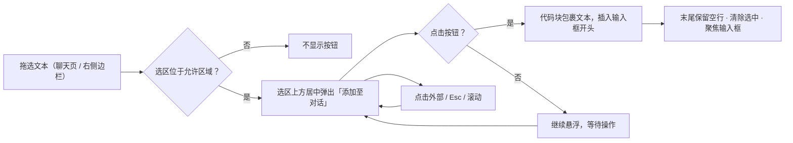

<div align="center">

# dsh-session-plus

**会话增强插件：模型提供商头部 · 选中文本一键加入输入框 · 账户菜单三态主题切换 · Codex 风格推理等级滑条 · 新建会话页「在应用中打开」按钮 —— 每一项都在「设置 → 通用」里有独立开关**

[](README.md)
[](README_en.md)


</div>

<!-- 预览图占位：补充截图 / GIF 后替换本注释，勿链接不存在的图片。
<p align="center"></p>
-->

**dsh-session-plus** 是 [DeepSeek Harness](https://github.com/deepseek-ai)（DSH）的会话增强插件，提供五项轻量增强 + 一个统一开关面板：

- 🏷 模型选择菜单顶部**实时展示**当前请求使用的模型提供商
- ✂️ 选中任意文本，一键以 Markdown 代码块形式**加入输入框开头**
- 🎚 账户菜单最上方提供 `跟随系统 / 浅色 / 深色` **主题快捷切换**（react-bits Rubber Segment 动效）
- 🎛 官方模型菜单「推理等级」一行改造为 **Codex 风格连续滑条**（一档一色 + 最高档能量层，迁自 `dsh-codex-effort-slider`）
- 🪟 新建会话页标题栏补上 **Open In… 分体按钮**（官方只在对话页提供；固定定位在整组按钮最左侧，右侧面板展开时自动隐藏）
- ⚙️ 「设置 → 通用」里为以上**每一项**提供独立开关（直接复用官方 `Switch` 组件，样式与官方行一致），即时生效、可随时关掉

> [!NOTE]
> **自 v0.4.0 起，「打开工作区」不再由本插件独立实现。** DSH 已内置功能完整的 **Open In…** 分体按钮（会话页头部右上角）；本插件只做两件事：不再重复提供该能力，并在 **v0.7.0** 把这个官方按钮**补到新建会话页**（那里官方不渲染该行工具区），行为与官方完全一致。

## 📑 目录

- [✨ 功能特性](#-功能特性)
- [🚀 快速开始](#-快速开始)
- [📖 使用说明](#-使用说明)
- [🧪 测试](#-测试)
- [🗂 项目结构](#-项目结构)
- [🛠 技术栈](#-技术栈)
- [🧭 路线图](#-路线图)
- [📄 许可证](#-许可证)

---

## ✨ 功能特性

### 1️⃣ 模型提供商头部

| 特性 | 说明 |
|---|---|
| 菜单头部展示 | 模型选择菜单最上方注入 `提供商：xxx` 说明行，一眼看清当前请求走哪家 |
| 显示名优先 | 使用模型目录中的提供商显示名（与菜单内分组标题同源）；目录缺失时回退原始 provider id |
| 实时跟随 | 菜单打开期间订阅会话模型目录，切换模型 / 提供商后头部即时更新 |
| 空态占位 | 目录尚未加载出选中时显示「—」，加载完成后自动变为提供商名 |
| 双语文案 | 随界面语言自动切换（简体中文 / English） |
| 只读无侵扰 | 纯展示、不可交互、不可聚焦；不触碰自带菜单的行为与样式，`/model` 弹出选择器保持原样 |

### 2️⃣ 选中文本 → 添加至对话

| 特性 | 说明 |
|---|---|
| 悬浮按钮 | 在**聊天页消息区**或 **官方 / better-sidebar 右侧预览**中选中文本，选区上方居中弹出「添加至对话」；顶部空间不足自动翻转到下方 |
| 开头插入 | 点击后以 Markdown 代码块（无语言标注围栏）插入**输入框开头**；已有草稿保留在块后（空一行分隔） |
| 末尾空行 | 插入结果整体末尾保留一行空行，便于后续直接续写 |
| 固定三反引号 | 围栏一律为 ```` ``` ````（产品要求只展示 ```` ``` ````） |
| 标准工具栏行为 | 点击外部 / Escape / 选区折叠 / 消息区滚动即隐藏；滚动停止且选区重新入屏自动恢复；点击后清除选中、隐藏按钮、聚焦输入框 |
| 范围克制 | 仅在所属聊天消息区与右侧预览触发；输入框、侧栏、设置页等其余区域不弹按钮 |
| 不限制长度 | 整段原样包裹，无长度上限 |



### 3️⃣ 账户菜单主题快捷切换

| 特性 | 说明 |
|---|---|
| 菜单最上方 | 在账户菜单（`设置` / `意见反馈` / `退出登录`）弹层顶部注入三态切换条，位于「设置」之上 |
| 三态切换 | `跟随系统` / `浅色` / `深色`；与「设置 → 通用 → 外观」共用同一条偏好，任一处修改另一处即时同步 |
| Rubber Segment | 还原 react-bits 橡胶滑块：跨段拉伸 → 收缩落位挤压，支持按住拖拽与甩动惯量；`prefers-reduced-motion` 下直接落位 |
| 键鼠一致 | 方向键 / Home / End 切换；滑块刻意不使用 `button`，因此菜单原有的焦点与方向键序列完全不变 |
| 不打断操作 | 点击或拖拽切换后菜单保持打开，可连续比较三种主题 |
| 主题自适应 | 轨道、滑块与文字全部使用 DSH 主题 token，深浅色下与外层菜单同色阶 |
| 安全降级 | 账户菜单由官方 `settings.launcher` 席位提供；席位或菜单结构不匹配时静默不注入，另两项功能照常 |

### 4️⃣ 推理等级滑条

| 特性 | 说明 |
|---|---|
| 不新增入口 | 直接改造官方模型菜单里的「推理等级」那一行：加高、允许折行，滑条作为第二行铺满整行；官方 label / value / chevron 一个不动 |
| 连续跟手 | 拖动过程中即时切换档位（不用等松手）；松手按指针速度做落点外推与吸附，档位数随模型自适应（2 / 4 / 6 档均可） |
| 一档一色 | 填充从蓝渐变到紫罗兰，越往右越「通电」；最高档亮起紫色能量层、扫光与 22 颗星尘粒子，整行描一圈紫边 |
| 座席同步 | 输入框里模型按钮上的档位文字与菜单行内数值同步按档位着色，`Off` 档保持官方灰 |
| 写回可靠 | `directory.select({ provider, model, reasoningEffort })`；同档去重 + 在途合并 + 120 ms 降频 + 10 s 超时回滚，失败时行内提示而不假装成功 |
| 动画口径 | 固定上游的「完整」动画，**不受系统「减少动态效果」影响**；刻度点固定为「亮白显示已到达档位」 |
| 无右键面板 | 滑条本体不提供任何右键 / 长按 / 菜单键面板，并在 window 捕获阶段截住这些事件，旧版本残留的 document 级监听也弹不出面板；要开关滑条请到「设置 → 通用」 |
| 安全降级 | 找不到官方那一行、模型没有推理档位、或会话目录未就绪时什么都不做，官方菜单保持原样 |
| 署名 | 迁移自 MIT 许可的 `dsh-codex-effort-slider@1.1.3`，来源与改动见 [NOTICE.md](NOTICE.md) |

### 5️⃣ 新建会话页「在应用中打开」按钮

| 特性 | 说明 |
|---|---|
| 补齐官方缺口 | 官方只把 Open In… 分体按钮放在**已有对话**的会话页头部；**新建会话页**（已选工作区、尚未发消息）那一行工具区不渲染，本插件在那里补一个同款按钮 |
| 位置精确 | 以官方「展开右侧面板」按钮所在行为锚点，**固定定位**在整组按钮（官方按钮 + `dsh-better-sidebar` / `dsh-awesome-hud` 的浮动按钮）的**最左侧**，与最近按钮保持 8px 间距；宿主挂 `document.body`，不占用标题栏排版，因此不会挤占其它插件的测量空间、也不会与它们叠压 |
| 随动重测 | 按钮簇增删、窗口缩放、侧栏开合后自动重新落位（`MutationObserver` + `resize` + 500ms 兜底轮询）；落位前隐藏，避免首帧闪到视口左上角 |
| 垂直对齐 | 与官方 28px 角落按钮垂直居中对齐（按锚点实际矩形计算，兼容 Windows 原生标题栏高度） |
| 行为一致 | 左格=当前默认应用图标，点击用该应用打开当前会话的工作区；右格箭头弹出已安装应用列表，选择后记住并立即打开 |
| 偏好共享 | 首次从官方 `dsh.open-in-app.choice` **只读**继承默认应用；本插件用 `dsh.session-plus.open-in-app.v1` 记录自己的选择，绝不改写官方状态 |
| 自动让位 | 发出第一条消息后（页面进入对话态）本插件按钮立即卸载，只剩官方那一个，永不重复 |
| 面板互斥 | 打开右侧面板时隐藏，收起后立即恢复 |
| 无工作区不显示 | 会话还没有工作区目录（`cwd`）时不显示，避免点了没反应 |
| 失败反馈 | 宿主返回失败时提示「打开失败，请重试」，3 秒后自动消失 |
| 安全降级 | 官方应用目录路由不可用或返回空列表时整颗按钮不渲染（与官方一致），其余功能不受影响 |
| 文案署名 | 按钮文案与 34 个应用显示名镜像官方 `@deepseek-ai/dsh-client-ui-open-in-app`（MIT），见 [NOTICE.md](NOTICE.md) |

### 6️⃣ 通用设置里的逐项开关

| 特性 | 说明 |
|---|---|
| 位置 | 「设置 → 通用」，紧接官方「在使用官方模型 API 时上传 Session Log」行**下方**、「当前版本」行上方 |
| 五项独立 | 提供商头部 / 选中文本加入对话 / 账户菜单主题切换 / 推理等级滑条 / 新建会话页按钮，各一个开关，互不影响 |
| 即时生效 | 关掉后对应 UI 与注入立即移除（定时器、监听、DOM、样式一并回收），重新打开立即回来，无需刷新或重启 |
| 官方同款 | 直接复用官方 `@deepseek-ai/dsh-client-ui-primitives` 的 `Switch` 组件——与官方设置行同一组件、同一份 CSS（含 `corner-shape:round`），计算样式逐项一致；旧运行时没有该原语时退回自绘开关（CSS 镜像官方） |
| 原生回退 | 关闭「推理等级滑条」后，官方原生「推理等级」行原样回来（行高、折行、内边距全部还原） |
| 默认全开 | 升级后行为保持不变；偏好存在浏览器 `localStorage` 的 `dsh.session-plus.features.v1` |
| 容错 | `localStorage` 不可用或内容损坏时退回「全开」并在内存生效，不报错 |

---

## 🚀 快速开始

### 1. Web 端安装

```bash
cd <absolute-path-to-plugin> && pnpm install
dsh plugin --profile web add "dsh-session-plus@link:<absolute-path-to-plugin>"
```

### 桌面端安装

当前版本：**v0.7.1**。先完全退出 DeepSeek Harness，再使用应用自带 CLI 安装到 `desktop` profile；旧 Web CLI 不能管理该保留 profile。

```bash
"<path-to-desktop-cli>" plugin --profile desktop add "dsh-session-plus@link:<absolute-path-to-plugin>"
```

macOS 默认安装位置的 CLI 为 `/Applications/DeepSeek Harness.app/Contents/Resources/runtime/cli/bin/dsh`。插件路径可含空格，保留命令中的引号。安装后重新打开桌面应用。

卸载同样需退出应用，再运行：

```bash
"<path-to-desktop-cli>" plugin --profile desktop remove dsh-session-plus
```

### 2. Web 端重启并验证

本插件为 **bundle 层插件**，安装后需重启 `dsh web` 才生效：

```bash
# 终端中 Ctrl+C 停止后重新启动
npm exec @deepseek-ai/dsh web
```

重启后打开任意会话：

- 点击输入框的模型选择按钮，菜单顶部显示当前提供商
- 在消息区拖选文本，选区上方出现「添加至对话」
- 点击左下角账号卡片，菜单最上方出现 `跟随系统 / 浅色 / 深色` 切换条

> [!NOTE]
> 会话页头部右上角若出现「Open In…」按钮，那是 **DSH 自带**能力，与本插件无关。

### 升级与回滚

<details>
<summary>点击展开</summary>

**v0.7.1**：修掉两个 UI 问题。① 「设置 → 通用」的 5 个功能开关改为直接复用官方 `Switch` 组件——此前自绘开关缺少 `corner-shape:round`，在 DSH 0.2.1-rc.3 的全局 `corner-shape: superellipse(1.5)` 下被渲染成圆角方形，与官方开关不一致；② 新建会话页「在应用中打开」按钮改为 `document.body` 上的固定定位：以官方展开按钮所在行为锚点，始终排在整组按钮最左侧，不再塞进标题栏角落容器挤占 `dsh-better-sidebar` / `dsh-awesome-hud` 浮动按钮的测量空间（那会让两个插件互相叠压）。浏览器夹具新增两个邻居站位块与官方 `Switch` 参照件，单元测试 79 → 85、浏览器回归 29 → 31。

**v0.7.0**：新增新建会话页「在应用中打开」分体按钮（补齐官方空会话页不渲染该行的缺口，复用宿主路由与偏好继承）与「设置 → 通用」里的 5 个逐项功能开关（`settings.general.item` 席位、即时生效、`localStorage` 持久化），并新增对应离线/浏览器用例。

**v0.6.0**：新增官方模型菜单「推理等级」行的 Codex 风格滑条（迁自 MIT 许可的 `dsh-codex-effort-slider@1.1.3`：连续跟手、一档一色、最高档能量层与星尘、座席同步着色、写回去重与超时回滚）；新增离线测试台与 10 项行为断言、6 项真实 `ModelSelect` 浏览器用例，并加一层右键拦截保证不会弹出任何设置面板，并补 `NOTICE.md` 保留上游署名。

**v0.5.0**：新增账户菜单顶部三态主题快捷切换（react-bits Rubber Segment：拉伸跨段、落位挤压、拖拽橡皮筋与甩动惯量，支持减弱动效）；新增 `lib/rubber.js`、`lib/account-menu.js` 纯函数与对应单测；浏览器夹具适配当前桌面构建（动态解析官方前端入口标记、加载官方样式表、修复模型菜单夹具），并新增 7 项主题切换浏览器回归。

**v0.4.2**：适配 DSH 桌面端 `0.2.0-rc.2` 的分层模型菜单和富文本输入框；限制 DOM 操作到所属会话，避免主会话与侧会话串用提供商或草稿。修复同一位置重新选中及滚动后按钮不恢复，支持官方右侧栏预览，清理卸载后的菜单头部与监听器。

**升级**：重新运行对应 profile 的安装命令。Web 端重启 `dsh web`；桌面端完全退出后安装并重新打开。

**回滚**：

```bash
dsh plugin --profile web remove dsh-session-plus
# 重启 dsh web 完成卸载
```

</details>

---

## 📖 使用说明

### 模型提供商头部

- **位置**：模型选择菜单最顶端（菜单开启即出现）。
- **内容**：`提供商：<显示名>`；目录缺失该提供商时显示原始 id；未加载出选中时显示「—」。
- **实时性**：打开期间切换模型 / 提供商，头部立即刷新；关闭菜单或卸载组件时清理头部，下次开启重新注入。
- **无副作用**：模型列表滚动、推理等级、键盘导航均不受影响；`/model` 弹出选择器无注入。

### 选中文本 → 添加至对话

- **触发**：在聊天页消息区（助手回复或用户消息）或官方 / better-sidebar 右侧预览中按住鼠标拖选文本，松开后选区上方出现「添加至对话」。
- **插入结果**：点击后输入框开头出现 ``` 包裹的代码块；已有草稿保留在块后（空一行分隔）；整体末尾保留一行空行。
- **隐藏时机**：点击外部、按下 Escape、选区折叠、滚动消息区即隐藏；滚动停止且选区重新出现在屏幕中时自动恢复；点击按钮后自动清除选中并聚焦输入框。
- **边界**：输入框 / 左侧会话列表 / 设置页内的选中不会触发。只读或正在提交的输入框不允许插入；内嵌会话选文只写入它自己的草稿，普通右侧预览写入所属主会话。 iframe 内部选区不在本插件支持范围内。

> [!NOTE]
> 围栏一律为三个反引号。选中文本本身含三个反引号时，可能影响该代码块在 Markdown 中的渲染，属已知限制。

### 主题快捷切换

- **位置**：左下角账户菜单弹层最上方（点击左下角账号卡片展开）。
- **状态**：`跟随系统`（默认，随操作系统深浅色自动变化）/ `浅色` / `深色`；与「设置 → 通用 → 外观」是同一个偏好，任一处修改另一处即时同步。
- **操作**：点击分段、方向键 / Home / End，或按住滑块拖拽后松手（松手才落定，避免拖动过程中反复写入偏好与整页重绘）。
- **不打断**：切换后菜单保持打开，可连续比较三种主题。
- **边界**：账户菜单由官方 `settings.launcher` 席位提供；若该席位被第三方侧边栏接管、或 DSH 改动了菜单结构，切换条会静默不出现（不影响提供商头部与选文插入）。

### 推理等级滑条

- **位置**：点开输入框下方的模型菜单后，「推理等级」那一行下面新增一条滑条（该行因此被加高）。
- **操作**：按住轨道拖动即可，拖到哪一档就实时变成哪一档；松手后会按指针速度做落点外推并吸附到最近档位。也支持键盘：聚焦滑条后按方向键 / Home / End。
- **着色**：一档一色；拖到最高档时轨道亮起紫色能量层与星尘，输入框模型按钮上的档位文字同步变色。
- **写入**：松手（或键盘切换）后写回宿主，与官方「推理等级」子面板选择是同一个偏好；写入失败或超时会回滚并在行内提示。
- **边界**：官方模型菜单结构变化、或当前模型本身没有推理档位时，滑条不出现，官方菜单不受影响。

### 新建会话页「在应用中打开」

- **位置**：点侧边栏某个工作区进入的新会话页（空白、未发消息），标题栏右侧那组按钮的**最左侧**（固定定位；官方展开按钮、`dsh-better-sidebar` 与 `dsh-awesome-hud` 的浮动按钮都在它右侧，8px 间距、互不重叠）。
- **操作**：点左格用当前默认应用打开该工作区；点右格从已安装应用里选一个，选择会被记住。
- **隐藏时机**：打开右侧面板时隐藏、收起后恢复；发出第一条消息后不再显示（对话页由官方那一个按钮接管）。
- **快捷键**：与官方命令共用（默认 ⌥⌘O），悬停提示里显示当前键位。
- **失败**：宿主拒绝或网络失败时提示「打开失败，请重试」。
- **边界**：宿主没有可用的本地应用、或会话还没有工作区目录时不显示。

### 通用设置开关

- **位置**：「设置 → 通用」，官方「在使用官方模型 API 时上传 Session Log」行下方。
- **用法**：点右侧开关即可；开关是官方 `Switch` 组件，与官方设置行外观一致；关闭后相关 UI 立刻消失，重新打开立刻回来。
- **持久化**：偏好保存在浏览器 `localStorage`（键 `dsh.session-plus.features.v1`）。若本地服务端口变化导致页面 origin 改变，偏好会回到默认「全开」——这是浏览器存储的固有限制，故默认值刻意选为「全开」。

### 支持范围

| 项目 | 范围 |
|---|---|
| DSH | 桌面 `0.2.1-rc.3`（本版按该版本包体核对）；保留旧版 Web 的 `menu` / textarea 接口兼容 |
| 平台 | 官方桌面前端由浏览器夹具验证；Windows 原生桌面未实测 |
| 主题切换 | 依赖官方 `settings.launcher` 席位与 `role="menu"` 弹层结构，结构变化时静默降级 |
| 推理等级滑条 | 依赖官方模型菜单「推理等级」行（`button[role="menuitem"]` + label/value span）与 `modelDirectories` 服务，结构变化时静默降级 |
| 新建会话页按钮 | 依赖官方 `conversation.hero.options` 席位、标题栏官方「展开右侧面板」按钮（`[data-sidebar-right-expand]`，及其所在的 `[data-conversation-header-corner]` 容器）作为锚点，以及宿主路由 `GET /open-in-app/apps`、`POST /open-in-app/open`；任一缺失即静默不渲染。按钮是 `document.body` 上的固定定位节点，不依赖角落容器的排版 |
| 通用设置开关 | 依赖官方 `settings.general.item` 席位与官方 `@deepseek-ai/dsh-client-ui-primitives` 的 `Switch`（原语缺失时退回自绘开关）；席位不存在时 5 行开关不出现，其余功能照常 |
| 浏览器 | 现代 Chrome / Safari / Edge |

---

## 🧪 测试

```bash
npm test
```

共 **85 项单元测试 + 31 项浏览器回归测试**。浏览器测试需要验收环境提供 DSH 官方运行时与 Playwright；普通 `npm test` 会跳过这 31 项。启用夹具的命令如下（仅操作临时页面，不调用模型）：

```bash
SESSION_PLUS_TEST_RUNTIME="<path-to-extracted-desktop-dsh>" \
SESSION_PLUS_TEST_PLAYWRIGHT="<path-to-playwright-package>" \
SESSION_PLUS_TEST_BROWSER="<path-to-chromium-executable>" \
node --test test/*.test.mjs
```

<details>
<summary>如何准备 <code>&lt;path-to-extracted-desktop-dsh&gt;</code></summary>

夹具只读取两个包：`@deepseek-ai/dsh-web-frontend`（官方前端入口与样式表）和 `@deepseek-ai/dsh-client-ui-model-selection`（模型菜单组件）。从桌面应用 `Contents/Resources/app.asar` 中解出 `dsh/node_modules/@deepseek-ai/` 下对应目录即可，解包后布局需为 `<runtime>/node_modules/@deepseek-ai/dsh-web-frontend/dist/assets/index-*.js`。

`app.asar` 数据区起点 = `8 + readUInt32LE(4)`（不是 `16 + readUInt32LE(12)`，后者会让每个文件多出 1~2 字节偏移）。官方样式表必须一并注入页面，Menu 的 `position: fixed` 与主题 token 都来自它，否则弹层会退化为文档流、菜单几何反查失效。

</details>

测试覆盖：

- **提供商名解析**：显示名优先 / 缺失回退原始 id / 空态占位符 / 空分组与空名称容错
- **代码块插入**：围栏固定为 ```` ``` ```` / 开头拼接 / 空草稿 / 末尾空行幂等 / 含 ```` ``` ```` 文本仍用 ```` ``` ````
- **宿主半区挂载**：导出面精确为 `name` + `apply`（空实现、不声明 `inject`）—— 守护「宿主行必须保留」
- **Rubber Segment 数学**：橡皮筋阻尼 / 速度投影 / 采样窗口 / 最近段判定 / 拉伸与挤压方向 / 缓动曲线
- **账户菜单锚定**：侧上落点、视口夹紧、4px 容差内接受与超出拒绝、插入后自校正
- **浏览器运行时**：官方模型菜单、实时目录更新、多会话隔离、富文本 / textarea 焦点恢复、选区重显、侧栏与编辑区边界、Windows 标题栏避让与卸载清理
- **主题切换（真实 Menu 原语）**：注入位置与面板贴合、点击只写一次且菜单不关、拖拽单次落定、方向键与焦点、关闭清理与重开回显、外部改主题跟随、减弱动效直接落位、其它弹层不误注入
- **推理等级滑条（离线台）**：注入进官方那一行（内距 / 折行 / 高度，官方 span 与 chevron 保留）、档位映射与滞回吸附、能量与粒子数学、运动引擎收敛且无过冲、写回契约（单次提交、参数正确、同档去重）、失败回滚与行内提示、关菜单逐项还原、关菜单时 fail-open、座席着色、本地化回退
- **推理等级滑条（真实 ModelSelect）**：滑条铺满官方行的第二行、拖到最右端只写一次 `max` 且菜单保持打开、关闭后行内样式还原、键盘 End / ArrowLeft 切换并写回、右键不弹出任何设置面板（含拦截 document 上同类监听）、模型没有推理档位时不注入
- **功能开关（离线）**：默认全开、`localStorage` 读写与回读、损坏 JSON / 非对象 / 非法值容错、隐私模式写入失败容错、未知 id 忽略、订阅去重与退订、`reset` 重读、设置行 order 与中英文案键完整性
- **在应用中打开（离线）**：三个宿主路由常量、请求体与失败返回、应用目录只读一次与空列表 / 非 2xx / 断网降级、偏好继承（自有键优先、官方键裸字符串与 JSON 两种写法）、应用名回退、四条可见性条件真值表、面板展开判定的服务与 DOM 双通道、按钮簇落点几何（最左侧 8px 间距 / 跨行按钮忽略 / 极窄窗口贴边 / 锚点或尺寸缺失返回 null）
- **在应用中打开（真实 DOM）**：空会话页出现且固定定位在整组按钮最左侧（`dsh-better-sidebar` / `dsh-awesome-hud` 站位块在右侧且不重叠、8px 间距、垂直居中）、邻居按钮消失后重新贴齐、发出消息后卸载且不残留宿主节点、右侧面板展开隐藏 / 收起恢复、主按钮请求体正确、应用菜单切换并写入偏好、失败提示自动消失
- **功能开关（真实 DOM）**：5 行开关落在官方上传行之后且顺序稳定，开关复用官方 `Switch` 且与官方参照件的计算样式逐项一致；关闭提供商头部 / 选文浮层 / 推理滑条 / 主题三态条 / 新会话按钮后即时移除，重新开启即时恢复（含滑条关闭后官方行的行高、折行、内边距逐项还原）
- **浏览器半区注册面**：`conversation.input.overlay` 两条 + `conversation.input.right` 一条 + `conversation.hero.options` 一条 + `settings.general.item` 五行注册、六十五个词典键、样式 effect、模型服务 / 主题服务缺失时的降级

---

## 🗂 项目结构

```text
dsh-session-plus/
├── lib/
│   ├── client.js        # 浏览器半区：提供商头部 + 选中添加 + 主题切换 + 推理滑条 + 新会话打开按钮 + 开关面板（单 bundle）
│   ├── index.js         # 宿主半区：刻意保留的空 apply（让浏览器半区被 dsh-client-modules 发现）
│   ├── insert.js        # 选中文本 → 代码块拼接纯函数（可单测）
│   ├── label.js         # 提供商名解析纯函数（可单测）
│   ├── rubber.js        # Rubber Segment 几何与动效数学（可单测）
│   └── account-menu.js  # 账户菜单落点识别纯几何（可单测）
├── test/                # 单元测试与官方前端浏览器夹具
├── cordis.patch.yml
├── CHANGELOG.md
├── NOTICE.md            # 第三方来源与 MIT 声明（dsh-codex-effort-slider 迁移 + 官方 open-in-app 文案/视觉镜像）
├── package.json
└── LICENSE
```

---

## 🛠 技术栈

| 类别 | 技术 |
|---|---|
| 运行时 | DeepSeek Harness（DSH `0.2.1-rc.3`）· Cordis 插件系统 |
| 语言 | 原生 JavaScript（ESM，无构建步骤） |
| 浏览器侧 | DSH client runtime（`@deepseek-ai/dsh-client-*`），单 bundle 注入 |
| 宿主侧 | 无运行时依赖：空 `apply` 宿主行，保留它是为了让浏览器半区被 `dsh-client-modules` 发现 |
| 样式 | DSH 主题变量（`--dsw-alias-*`），客户端生命周期内挂载并清理样式 |
| 测试 | Node 内置测试运行器（`node --test`） |

---

## 🧭 路线图

- [x] 模型选择菜单提供商头部（实时跟随 + 双语文案）
- [x] 选中文本 → 添加至对话（悬浮按钮 + 代码块插入）
- [x] 触发范围限定（所属聊天页 + 右侧预览）
- [x] 桌面富文本输入框、分层模型菜单与多会话隔离
- [x] 插入结果末尾空行
- [x] 移除「打开工作区」（DSH 已内置 Open In… 取代，保留另外两项功能）
- [x] 账户菜单主题快捷切换（Rubber Segment、拖拽惯量、减弱动效）
- [x] 推理等级滑条（迁自 `dsh-codex-effort-slider`：连续跟手、一档一色、最高档能量层）
- [x] 新建会话页「在应用中打开」按钮（同款分体按钮、固定定位在按钮组最左且不与其它插件叠压、面板互斥、偏好继承）
- [x] 通用设置逐项开关（5 项独立、复用官方 `Switch`、即时生效、原生回退、`localStorage` 持久化）
- [ ] 选中文本内含围栏时的转义 / 容错处理
- [ ] 插入位置可选（开头 / 末尾 / 光标处）

---

## 📄 许可证

本项目基于 [MIT](LICENSE) 许可证发布（SPDX: `MIT`）。

其中：

- 「推理等级滑条」迁移自 MIT 许可的 `dsh-codex-effort-slider`；
- 「新建会话页按钮」的视觉参数、按钮文案与 34 个应用显示名镜像自 MIT 许可的官方包 `@deepseek-ai/dsh-client-ui-open-in-app`（未复制其代码，仅复用其宿主 HTTP 路由契约）；
- 「设置 → 通用」开关在运行时直接复用 MIT 许可的官方原语 `@deepseek-ai/dsh-client-ui-primitives` 的 `Switch`（未复制代码），仅在旧运行时退回自绘开关，其兜底 CSS 几何参数参考官方 `Switch.module.css`。

第三方版权声明与改动范围见 [NOTICE.md](NOTICE.md)。
