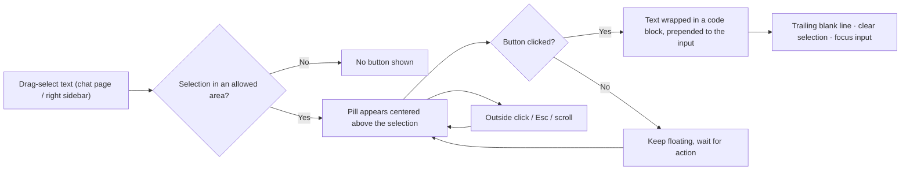

<div align="center">

# dsh-session-plus

**Session enhancement plugin: live model provider in the model menu · turn selected text into a code block at the start of the input · three-state theme switch at the top of the account menu**

[](README.md)
[](README_en.md)


</div>

<!-- Preview placeholder: replace this comment once a screenshot / GIF exists; never link a missing image.
<p align="center"></p>
-->

**dsh-session-plus** is a session enhancement plugin for [DeepSeek Harness](https://github.com/deepseek-ai) (DSH) that adds three lightweight boosts:

- 🏷 **Show** the active model provider at the top of the model selection menu, in real time
- ✂️ Turn any selected text into a Markdown code block, **prepended** to the input, with one click
- 🎚 A `System / Light / Dark` **theme shortcut** at the very top of the account menu (react-bits Rubber Segment motion)

> [!NOTE]
> **As of v0.4.0, "Open Workspace" has been removed from this plugin.** DSH `0.1.5-rc.1` ships a richer built-in **Open In…** split button (top-right of the session header) that opens the session workspace in an installed directory app, so this plugin no longer duplicates it. The provider header and selection insertion remain available.

## 📑 Table of Contents

- [✨ Features](#-features)
- [🚀 Quick Start](#-quick-start)
- [📖 Usage](#-usage)
- [🧪 Tests](#-tests)
- [🗂 Project Structure](#-project-structure)
- [🛠 Tech Stack](#-tech-stack)
- [🧭 Roadmap](#-roadmap)
- [📄 License](#-license)

---

## ✨ Features

### 1️⃣ Model Provider Header

| Feature | Description |
|---|---|
| Menu header | Injects a quiet `Provider: xxx` info row at the top of the model selection menu |
| Display name first | Uses the provider display name from the model directory (same source as the in-menu group titles); falls back to the raw provider id when missing |
| Live updates | Subscribes to the per-session model directory while the menu is open; the header refreshes instantly on switch |
| Empty state | Shows `—` before the directory reports a selection, then resolves automatically |
| Bilingual copy | Follows the UI locale (简体中文 / English) |
| Read-only, non-invasive | Pure display, never interactive or focusable; never touches the shipped menu's behavior or styles; the `/model` popup stays untouched |

### 2️⃣ Selected Text → Add to Conversation

| Feature | Description |
|---|---|
| Floating button | Select text in the **chat message area** or the **official / better-sidebar right-side preview** — an "Add to conversation" pill appears centered above the selection; flips below when there's no room above |
| Prepend insertion | Clicking inserts the text as a Markdown code block (no language tag) at the **start** of the input; existing draft stays after it, separated by a blank line |
| Trailing blank line | The result ends with a blank line so you can keep typing right after |
| Fixed triple-backtick fence | Always uses ```` ``` ```` (product requirement: only ```` ``` ```` is shown) |
| Standard toolbar behavior | Hides on outside click / Escape / collapsed selection / message-area scroll; returns automatically when scrolling stops and the selection is visible again; after clicking, the selection clears, the button hides, and the input regains focus |
| Scoped | Triggers only in the owning message area and right-side previews; selections in the input, sidebar, or settings never show it |
| No length limit | Wraps the whole selection, unbounded |



### 3️⃣ Account-Menu Theme Shortcut

| Feature | Description |
|---|---|
| Top of the menu | Injects a three-state switch at the top of the account menu (`Settings` / `Feedback` / `Sign out`) popup, above "Settings" |
| Three states | `System` / `Light` / `Dark`; shares one preference with **Settings → General → Appearance**, so either place updates the other immediately |
| Rubber Segment | Ports the react-bits rubber thumb: stretch across slots, squash on landing, plus drag with flick momentum; lands instantly under `prefers-reduced-motion` |
| Mouse + keyboard | Arrow keys / Home / End switch states; the switch deliberately uses no `button` elements, so the menu's own focus and arrow-key order are unchanged |
| Non-interrupting | The menu stays open after click or drag, so the three themes can be compared back to back |
| Theme-aware | Track, thumb, and labels use DSH theme tokens only, matching the surrounding menu in both palettes |
| Safe fallback | The account menu comes from the official `settings.launcher` seat; when the seat or the menu structure does not match, the switch is silently skipped and the other two features keep working |

---

## 🚀 Quick Start

### 1. Web installation

```bash
cd <absolute-path-to-plugin> && pnpm install
dsh plugin --profile web add "dsh-session-plus@link:<absolute-path-to-plugin>"
```

### Desktop installation

Current version: **v0.5.0**. Fully quit DeepSeek Harness, then use its bundled CLI to install into the reserved `desktop` profile. The older Web CLI cannot manage that profile.

```bash
"<path-to-desktop-cli>" plugin --profile desktop add "dsh-session-plus@link:<absolute-path-to-plugin>"
```

The default macOS CLI is `/Applications/DeepSeek Harness.app/Contents/Resources/runtime/cli/bin/dsh`. Keep the quotes when the plugin path contains spaces. Reopen the desktop app after installation.

To uninstall, quit the app first, then run:

```bash
"<path-to-desktop-cli>" plugin --profile desktop remove dsh-session-plus
```

### 2. Restart Web and verify

This is a **bundle-layer plugin**; restart `dsh web` to activate:

```bash
# Stop with Ctrl+C in the terminal, then start again
npm exec @deepseek-ai/dsh web
```

After restart, open any session:

- Click the composer's model select — the menu shows the current provider at the top
- Drag-select text in the message area — the "Add to conversation" button appears
- Click the account card at the bottom left — a `System / Light / Dark` switch appears at the top of the menu

> [!NOTE]
> An **"Open In…"** button in the session header's top-right comes from **DSH itself**, not from this plugin.

### Upgrade & Rollback

<details>
<summary>Expand</summary>

**v0.5.0**: adds a three-state theme shortcut at the top of the account menu (react-bits Rubber Segment: stretch across slots, landing squash, drag rubber band and flick momentum, reduced-motion aware). Adds the `lib/rubber.js` and `lib/account-menu.js` pure modules with unit tests, adapts the browser fixtures to the current desktop build (dynamic detection of the official frontend entry markers, loading the official stylesheets, fixing the model-menu fixture), and adds 7 browser regressions for the theme switch.

**v0.4.2**: adapts the layered model menu and rich-text composer in DSH Desktop `0.2.0-rc.2`. DOM operations are scoped to their owning conversation to prevent provider and draft cross-talk. Fixes repeated selections and scroll recovery, supports official right-side previews, and removes headers and listeners on unmount.

**Upgrade**: rerun the installation command for the relevant profile. Restart `dsh web` for Web; fully quit Desktop before installation, then reopen it.

**Rollback**:

```bash
dsh plugin --profile web remove dsh-session-plus
# Restart dsh web to finish uninstall
```

</details>

---

## 📖 Usage

### Model Provider Header

- **Position**: first row of the model selection menu (appears as soon as the menu opens).
- **Content**: `Provider: <display name>`; raw provider id when the directory lacks the group; `—` before a selection is loaded.
- **Live**: switching models/providers while open refreshes the header immediately; closing the menu or unmounting the component removes it; reopening re-injects it.
- **No side effects**: model list scrolling, effort levels, and keyboard navigation are untouched; the `/model` popup is not injected.

### Selected Text → Add to Conversation

- **Trigger**: drag-select text in the chat message area (assistant reply or user message) or in the official / better-sidebar right-side preview; the "Add to conversation" button appears above the selection on release.
- **Result**: clicking puts a ```-fenced code block at the **start** of the input; existing draft content stays after it (blank line separated); the result ends with a trailing blank line.
- **Dismiss**: outside click, Escape, collapsed selection, or scrolling the message area hides it; it returns automatically once scrolling stops and the selection is visible again; after clicking, the selection clears and the input regains focus.
- **Edges**: input / left session list / settings selections never trigger. Read-only and submitting composers do not accept insertion. Embedded conversation selections target their own draft; regular right-side previews target their owning main conversation. Selections inside iframes are unsupported.

> [!NOTE]
> The fence is always three backticks. If the selected text itself contains three backticks, it may affect that block's Markdown rendering — a known limitation.

### Theme Shortcut

- **Position**: the very top of the account menu popup (open it from the account card at the bottom left).
- **States**: `System` (default, follows the OS light/dark setting) / `Light` / `Dark`; this is the same preference as **Settings → General → Appearance**, so changing either one updates the other immediately.
- **Interaction**: click a segment, use arrow keys / Home / End, or drag the thumb and release (the change commits on release, so a drag never writes the preference repeatedly).
- **Non-interrupting**: the menu stays open after switching, so you can compare the three themes.
- **Edges**: the account menu is provided by the official `settings.launcher` seat; if a third-party sidebar takes that seat over, or DSH changes the menu structure, the switch silently does not appear (the provider header and selection insertion are unaffected).

### Supported Scope

| Item | Scope |
|---|---|
| DSH | Desktop `0.2.1-rc.2`; retains legacy Web `menu` / textarea compatibility |
| OS | Official Desktop frontend verified in browser fixtures; native Windows Desktop untested |
| Browser | Modern Chrome / Safari / Edge |
| Theme switch | Relies on the official `settings.launcher` seat and the `role="menu"` popup structure; degrades silently when they change |

---

## 🧪 Tests

```bash
npm test
```

**39 unit tests + 13 browser regressions**. Browser tests require the official DSH runtime and Playwright supplied by the verification environment; plain `npm test` skips those 13 cases. Enable the isolated fixtures with the following command (no model calls):

```bash
SESSION_PLUS_TEST_RUNTIME="<path-to-extracted-desktop-dsh>" \
SESSION_PLUS_TEST_PLAYWRIGHT="<path-to-playwright-package>" \
SESSION_PLUS_TEST_BROWSER="<path-to-chromium-executable>" \
node --test test/*.test.mjs
```

<details>
<summary>How to prepare <code>&lt;path-to-extracted-desktop-dsh&gt;</code></summary>

The fixtures read only two packages: `@deepseek-ai/dsh-web-frontend` (official frontend entry and stylesheets) and `@deepseek-ai/dsh-client-ui-model-selection` (model menu component). Extract the matching directories under `dsh/node_modules/@deepseek-ai/` from the desktop app's `Contents/Resources/app.asar`; the resulting layout must look like `<runtime>/node_modules/@deepseek-ai/dsh-web-frontend/dist/assets/index-*.js`.

The asar data area starts at `8 + readUInt32LE(4)` (not `16 + readUInt32LE(12)`, which shifts every extracted file by 1–2 bytes). The official stylesheets must be injected into the page as well: Menu's `position: fixed` and the theme tokens come from them, otherwise the popup falls back to normal flow and the geometric menu detection cannot work.

</details>

Coverage:

- **Provider label**: display-name priority / raw-id fallback / empty-state placeholder / tolerance for empty groups and names
- **Code-block insertion**: fence always ```` ``` ```` / prepend composition / empty draft / trailing-blank-line idempotency / ```` ``` ```` inside text still uses ```` ``` ````
- **Host-half mounting**: export surface is exactly `name` + `apply` (a no-op without `inject`) — guards the "the host row must stay" constraint
- **Rubber Segment math**: rubber-band damping / velocity projection / sample window / nearest slot / stretch and squash directions / easing curve
- **Account-menu anchoring**: side-top placement, viewport clamping, 4px tolerance acceptance and rejection, post-insertion self-correction
- **Browser runtime**: official model menu, live directory updates, multi-session isolation, rich-text / textarea focus recovery, selection re-show, sidebar and composer boundaries, Windows title-bar avoidance, unmount cleanup
- **Theme switch (real Menu primitive)**: injection point and panel fit, single write per click without closing the menu, single commit per drag, arrow keys and focus, close cleanup and reopen state, external theme changes, reduced-motion landing, no injection into other popups
- **Browser-half registration surface**: only two `conversation.input.overlay` registrations, nine locale keys, dictionary and style effects intact, session-header / `shell.overlay` registrations verifiably gone, and graceful degradation when the model or theme service is missing

---

## 🗂 Project Structure

```text
dsh-session-plus/
├── lib/
│   ├── client.js        # Browser half: provider header + selected-text add + theme switch (single bundle)
│   ├── index.js         # Host half: deliberately empty apply (lets dsh-client-modules discover the browser half)
│   ├── insert.js        # Selected text → code-block composition (unit-testable)
│   ├── label.js         # Provider-label pure function (unit-testable)
│   ├── rubber.js        # Rubber Segment geometry and motion math (unit-testable)
│   └── account-menu.js  # Account-menu anchoring geometry (unit-testable)
├── test/                # unit tests and official-frontend browser fixtures
├── cordis.patch.yml
├── CHANGELOG.md
├── package.json
└── LICENSE
```

---

## 🛠 Tech Stack

| Category | Technology |
|---|---|
| Runtime | DeepSeek Harness (DSH `0.2.1-rc.2`) · Cordis plugin system |
| Language | Plain JavaScript (ESM, no build step) |
| Browser side | DSH client runtime (`@deepseek-ai/dsh-client-*`), injected as a single bundle |
| Host side | No runtime dependencies: an empty `apply` host row, kept so `dsh-client-modules` discovers the browser half |
| Styling | DSH theme variables (`--dsw-alias-*`), styles mounted and removed with the client lifecycle |
| Tests | Node built-in test runner (`node --test`) |

---

## 🧭 Roadmap

- [x] Model provider header (live updates + bilingual copy)
- [x] Selected text → add to conversation (floating button + code-block insertion)
- [x] Scoped triggers (owning chat page + right-side previews)
- [x] Desktop rich-text composer, layered model menu, and conversation isolation
- [x] Trailing blank line after insertion
- [x] Remove "Open Workspace" (superseded by DSH's built-in Open In…, other two features retained)
- [x] Account-menu theme shortcut (Rubber Segment, drag momentum, reduced motion)
- [ ] Escaping / tolerance for fences inside the selected text
- [ ] Insert position options (start / end / cursor)

---

## 📄 License

This project is released under the [MIT](LICENSE) license (SPDX: `MIT`).
