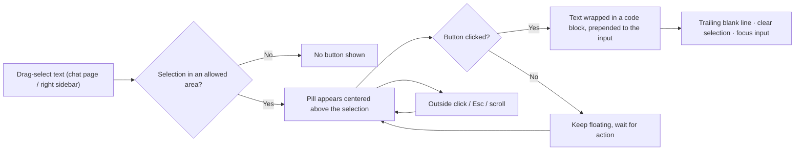

<div align="center">

# dsh-session-plus

**Session enhancement plugin: live model provider in the model menu · turn selected text into a code block · three-state theme switch in the account menu · Codex-style reasoning-effort slider · an “Open in app” button on the new-session page — each one toggleable in Settings → General**

[](README.md)
[](README_en.md)


</div>

<!-- Preview placeholder: replace this comment once a screenshot / GIF exists; never link a missing image.
<p align="center"></p>
-->

**dsh-session-plus** is a session enhancement plugin for [DeepSeek Harness](https://github.com/deepseek-ai) (DSH) that adds five lightweight boosts plus one switch panel:

- 🏷 **Show** the active model provider at the top of the model selection menu, in real time
- ✂️ Turn any selected text into a Markdown code block, **prepended** to the input, with one click
- 🎚 A `System / Light / Dark` **theme shortcut** at the very top of the account menu (react-bits Rubber Segment motion)
- 🎛 A **Codex-style continuous slider** replacing the official `Reasoning effort` row (per-level colours plus a max-level energy layer, ported from `dsh-codex-effort-slider`)
- 🪟 The **Open In… split button** on the new-session page header, which the official UI only renders once a conversation exists (fixed-positioned as the leftmost control of the button group; hidden while the right panel is open)
- ⚙️ **One switch per feature** under Settings → General (the official `Switch` component itself, so the look matches the official rows), applied instantly

> [!NOTE]
> **As of v0.4.0, "Open Workspace" is no longer implemented by this plugin.** DSH ships its own richer **Open In…** split button in the session header; since **v0.7.0** this plugin simply mirrors that official button onto the **new-session page** (where the official utilities row is not rendered), with identical behaviour.

## 📑 Table of Contents

- [✨ Features](#-features)
- [🚀 Quick Start](#-quick-start)
- [📖 Usage](#-usage)
- [🧪 Tests](#-tests)
- [🗂 Project Structure](#-project-structure)
- [🛠 Tech Stack](#-tech-stack)
- [🧭 Roadmap](#-roadmap)
- [📄 License](#-license)

---

## ✨ Features

### 1️⃣ Model Provider Header

| Feature | Description |
|---|---|
| Menu header | Injects a quiet `Provider: xxx` info row at the top of the model selection menu |
| Display name first | Uses the provider display name from the model directory (same source as the in-menu group titles); falls back to the raw provider id when missing |
| Live updates | Subscribes to the per-session model directory while the menu is open; the header refreshes instantly on switch |
| Empty state | Shows `—` before the directory reports a selection, then resolves automatically |
| Bilingual copy | Follows the UI locale (简体中文 / English) |
| Read-only, non-invasive | Pure display, never interactive or focusable; never touches the shipped menu's behavior or styles; the `/model` popup stays untouched |

### 2️⃣ Selected Text → Add to Conversation

| Feature | Description |
|---|---|
| Floating button | Select text in the **chat message area** or the **official / better-sidebar right-side preview** — an "Add to conversation" pill appears centered above the selection; flips below when there's no room above |
| Prepend insertion | Clicking inserts the text as a Markdown code block (no language tag) at the **start** of the input; existing draft stays after it, separated by a blank line |
| Trailing blank line | The result ends with a blank line so you can keep typing right after |
| Fixed triple-backtick fence | Always uses ```` ``` ```` (product requirement: only ```` ``` ```` is shown) |
| Standard toolbar behavior | Hides on outside click / Escape / collapsed selection / message-area scroll; returns automatically when scrolling stops and the selection is visible again; after clicking, the selection clears, the button hides, and the input regains focus |
| Scoped | Triggers only in the owning message area and right-side previews; selections in the input, sidebar, or settings never show it |
| No length limit | Wraps the whole selection, unbounded |



### 3️⃣ Account-Menu Theme Shortcut

| Feature | Description |
|---|---|
| Top of the menu | Injects a three-state switch at the top of the account menu (`Settings` / `Feedback` / `Sign out`) popup, above "Settings" |
| Three states | `System` / `Light` / `Dark`; shares one preference with **Settings → General → Appearance**, so either place updates the other immediately |
| Rubber Segment | Ports the react-bits rubber thumb: stretch across slots, squash on landing, plus drag with flick momentum; lands instantly under `prefers-reduced-motion` |
| Mouse + keyboard | Arrow keys / Home / End switch states; the switch deliberately uses no `button` elements, so the menu's own focus and arrow-key order are unchanged |
| Non-interrupting | The menu stays open after click or drag, so the three themes can be compared back to back |
| Theme-aware | Track, thumb, and labels use DSH theme tokens only, matching the surrounding menu in both palettes |
| Safe fallback | The account menu comes from the official `settings.launcher` seat; when the seat or the menu structure does not match, the switch is silently skipped and the other two features keep working |

### 4️⃣ Reasoning-Effort Slider

| Feature | Description |
|---|---|
| No new entry point | Reworks the official `Reasoning effort` row itself: taller, wrapping, with the slider filling a second line; the official label / value / chevron are left untouched |
| Continuous drag | Levels change while you drag (no waiting for release); release projects the pointer velocity and snaps to the nearest level; level count adapts per model (2 / 4 / 6) |
| One colour per level | The fill runs from blue to violet, energising towards the right; the top level lights up a violet energy layer, a sweep, and 22 starfield particles, and the row gets a violet outline |
| Seat in sync | The effort text on the composer model button and the row value are tinted per level; the `Off` level keeps the official grey |
| Reliable writes | `directory.select({ provider, model, reasoningEffort })` with same-level dedupe, in-flight merge, 120 ms throttling, and a 10 s timeout rollback; failures show an inline message instead of pretending to succeed |
| Motion profile | Fixed to the upstream `full` motion and **unaffected by the OS reduce-motion setting**; ticks fixed to `highlight reached levels` |
| No context-menu panel | The slider itself never opens a right-click, long-press or context-menu popup, and a window-capture guard also stops leftover document-level listeners from the previous version. To turn the slider on or off, use Settings → General |
| Safe fallback | When the official row, the model effort levels, or the session directory is missing, nothing happens and the official menu stays as-is |
| Attribution | Ported from MIT-licensed `dsh-codex-effort-slider@1.1.3`; see [NOTICE.md](NOTICE.md) for provenance and the exact changes |

### 5️⃣ "Open in app" Button on the New-Session Page

| Trait | Behaviour |
|---|---|
| Fills an official gap | The official Open In… split button only exists in the header of a session that already has messages; on the **new-session page** that utilities row is not rendered, so this plugin renders the same split button there |
| Exact placement | Anchored to the row holding the official "expand right panel" button and **fixed-positioned** as the **leftmost** control of the whole group (the official button plus the floating buttons of `dsh-better-sidebar` / `dsh-awesome-hud`), 8px away from the nearest one. The host node lives on `document.body`, takes no space in the header layout, and therefore neither consumes the measuring space of the other plugins nor overlaps them |
| Live re-measure | Re-aligns automatically when buttons are added or removed, on window resize and on sidebar toggles (`MutationObserver` + `resize` + a 500ms fallback poll); hidden until placed, so it never flashes in the top-left corner |
| Vertical alignment | Centred on the official 28px corner button (computed from the anchor's real rect, so it also follows the native Windows title bar) |
| Same behaviour | The left cell shows the current default app and opens the session workspace in it; the chevron lists installed apps, remembers the pick, and opens immediately |
| Shared preference | Read-only inheritance from the official `dsh.open-in-app.choice` on first use; this plugin records its own choice under `dsh.session-plus.open-in-app.v1` and never rewrites the official value |
| Steps aside | As soon as the first message is sent the plugin button unmounts, leaving only the official one — never duplicated |
| Panel exclusion | Hidden while the right panel is expanded, restored the moment it collapses |
| No workspace, no button | Hidden when the session has no workspace directory (`cwd`) yet |
| Failure feedback | A "Could not open. Try again." notice appears when the host refuses, and disappears after 3 seconds |
| Safe fallback | The whole button is not rendered when the official apps route is unavailable or returns an empty list (same as the official behaviour); other features are unaffected |
| Attribution | Button copy and the 34 application names mirror MIT-licensed `@deepseek-ai/dsh-client-ui-open-in-app`; see [NOTICE.md](NOTICE.md) |

### 6️⃣ Per-Feature Switches in Settings → General

| Trait | Behaviour |
|---|---|
| Position | Settings → General, directly **below** the official "Upload Session Log when using the official model API" row and above the version row |
| Five independent switches | Provider header · selection insertion · account-menu theme switch · effort slider · new-session button — one switch each |
| Instant | Turning one off removes its UI and injections immediately (timers, listeners, DOM, styles are all released); turning it back on restores it — no reload, no restart |
| Official look | Renders the official `@deepseek-ai/dsh-client-ui-primitives` `Switch` directly — the same component and CSS as the official settings rows (including `corner-shape:round`), so every computed style matches. On older runtimes without that primitive it falls back to a self-drawn switch whose CSS mirrors the official one |
| Native fallback | Turning the effort slider off restores the official `Reasoning effort` row exactly (height, wrapping, padding) |
| On by default | Upgrading changes nothing; the preference lives in browser `localStorage` under `dsh.session-plus.features.v1` |
| Fault-tolerant | Unavailable or corrupt `localStorage` falls back to "everything on" in memory without throwing |

---

## 🚀 Quick Start

### 1. Web installation

```bash
cd <absolute-path-to-plugin> && pnpm install
dsh plugin --profile web add "dsh-session-plus@link:<absolute-path-to-plugin>"
```

### Desktop installation

Current version: **v0.7.1**. Fully quit DeepSeek Harness, then use its bundled CLI to install into the reserved `desktop` profile. The older Web CLI cannot manage that profile.

```bash
"<path-to-desktop-cli>" plugin --profile desktop add "dsh-session-plus@link:<absolute-path-to-plugin>"
```

The default macOS CLI is `/Applications/DeepSeek Harness.app/Contents/Resources/runtime/cli/bin/dsh`. Keep the quotes when the plugin path contains spaces. Reopen the desktop app after installation.

To uninstall, quit the app first, then run:

```bash
"<path-to-desktop-cli>" plugin --profile desktop remove dsh-session-plus
```

### 2. Restart Web and verify

This is a **bundle-layer plugin**; restart `dsh web` to activate:

```bash
# Stop with Ctrl+C in the terminal, then start again
npm exec @deepseek-ai/dsh web
```

After restart, open any session:

- Click the composer's model select — the menu shows the current provider at the top
- Drag-select text in the message area — the "Add to conversation" button appears
- Click the account card at the bottom left — a `System / Light / Dark` switch appears at the top of the menu

> [!NOTE]
> An **"Open In…"** button in the session header's top-right comes from **DSH itself**, not from this plugin.

### Upgrade & Rollback

<details>
<summary>Expand</summary>

**v0.7.1**: fixes two UI issues. (1) The five Settings → General switches now render the official `Switch` component: the previous self-drawn switch lacked `corner-shape:round`, so under DSH 0.2.1-rc.3's global `corner-shape: superellipse(1.5)` it was painted as a rounded square instead of matching the official switch. (2) The new-session "Open in app" button is now fixed-positioned on `document.body`: anchored to the official expand button's row and always the leftmost control of the whole group, instead of being inserted into the header corner container where it consumed the measuring space of the `dsh-better-sidebar` / `dsh-awesome-hud` floating buttons and made those two overlap. Browser fixtures gained two neighbour stand-ins plus an official-`Switch` reference; unit tests 79 → 85, browser regressions 29 → 31.

**v0.7.0**: adds the "Open in app" split button on the new-session page (filling the official gap where the empty-session utilities row is not rendered, reusing the host routes and shared preference) and the five per-feature switches in Settings → General (`settings.general.item` seat, instant effect, `localStorage` persistence), plus their offline and browser cases.

**v0.6.0**: adds a Codex-style slider for the official `Reasoning effort` row (ported from the MIT-licensed `dsh-codex-effort-slider@1.1.3`: continuous drag, one colour per level, max-level energy layer with starfield, seat tinting, dedupe plus timeout rollback), along with an offline harness with 10 behaviour assertions, 6 real-`ModelSelect` browser cases, and `NOTICE.md` for upstream attribution.

**v0.5.0**: adds a three-state theme shortcut at the top of the account menu (react-bits Rubber Segment: stretch across slots, landing squash, drag rubber band and flick momentum, reduced-motion aware). Adds the `lib/rubber.js` and `lib/account-menu.js` pure modules with unit tests, adapts the browser fixtures to the current desktop build (dynamic detection of the official frontend entry markers, loading the official stylesheets, fixing the model-menu fixture), and adds 7 browser regressions for the theme switch.

**v0.4.2**: adapts the layered model menu and rich-text composer in DSH Desktop `0.2.0-rc.2`. DOM operations are scoped to their owning conversation to prevent provider and draft cross-talk. Fixes repeated selections and scroll recovery, supports official right-side previews, and removes headers and listeners on unmount.

**Upgrade**: rerun the installation command for the relevant profile. Restart `dsh web` for Web; fully quit Desktop before installation, then reopen it.

**Rollback**:

```bash
dsh plugin --profile web remove dsh-session-plus
# Restart dsh web to finish uninstall
```

</details>

---

## 📖 Usage

### Model Provider Header

- **Position**: first row of the model selection menu (appears as soon as the menu opens).
- **Content**: `Provider: <display name>`; raw provider id when the directory lacks the group; `—` before a selection is loaded.
- **Live**: switching models/providers while open refreshes the header immediately; closing the menu or unmounting the component removes it; reopening re-injects it.
- **No side effects**: model list scrolling, effort levels, and keyboard navigation are untouched; the `/model` popup is not injected.

### Selected Text → Add to Conversation

- **Trigger**: drag-select text in the chat message area (assistant reply or user message) or in the official / better-sidebar right-side preview; the "Add to conversation" button appears above the selection on release.
- **Result**: clicking puts a ```-fenced code block at the **start** of the input; existing draft content stays after it (blank line separated); the result ends with a trailing blank line.
- **Dismiss**: outside click, Escape, collapsed selection, or scrolling the message area hides it; it returns automatically once scrolling stops and the selection is visible again; after clicking, the selection clears and the input regains focus.
- **Edges**: input / left session list / settings selections never trigger. Read-only and submitting composers do not accept insertion. Embedded conversation selections target their own draft; regular right-side previews target their owning main conversation. Selections inside iframes are unsupported.

> [!NOTE]
> The fence is always three backticks. If the selected text itself contains three backticks, it may affect that block's Markdown rendering — a known limitation.

### Theme Shortcut

- **Position**: the very top of the account menu popup (open it from the account card at the bottom left).
- **States**: `System` (default, follows the OS light/dark setting) / `Light` / `Dark`; this is the same preference as **Settings → General → Appearance**, so changing either one updates the other immediately.
- **Interaction**: click a segment, use arrow keys / Home / End, or drag the thumb and release (the change commits on release, so a drag never writes the preference repeatedly).
- **Non-interrupting**: the menu stays open after switching, so you can compare the three themes.
- **Edges**: the account menu is provided by the official `settings.launcher` seat; if a third-party sidebar takes that seat over, or DSH changes the menu structure, the switch silently does not appear (the provider header and selection insertion are unaffected).

### Reasoning-Effort Slider

- **Position**: open the model menu under the composer; the `Reasoning effort` row gains a slider underneath it (the row grows taller because of it).
- **Interaction**: hold and drag the track — the level changes as you drag. On release the pointer velocity is projected and the thumb snaps to the nearest level. Keyboard works too: focus the slider, then use the arrow keys / Home / End.
- **Colouring**: one colour per level; at the top level the track lights up with the violet energy layer and starfield, and the effort text on the composer model button is tinted to match.
- **Writes**: releasing (or switching with the keyboard) writes back to the host — the same preference as choosing a level in the official `Reasoning effort` sub-pane. Failures or timeouts roll the display back and show an inline message.
- **Edges**: if the official model menu changes shape, or the current model has no effort levels, the slider does not appear and the official menu is unaffected.

### "Open in app" on the New-Session Page

- **Position**: a new-session page opened from a workspace (blank, no messages): fixed-positioned as the **leftmost** control of the button group at the right of the header (the official expand button and the floating buttons of `dsh-better-sidebar` / `dsh-awesome-hud` all sit to its right with an 8px gap, never overlapping).
- **Interaction**: the left cell opens the workspace in the current default app; the chevron picks another installed app and remembers the choice.
- **Visibility**: hidden while the right panel is open and restored when it collapses; once the first message is sent the official button takes over.
- **Shortcut**: shared with the official command (default ⌥⌘O) and shown in the hover tooltip.
- **Failure**: a "Could not open. Try again." notice when the host or transport fails.
- **Edges**: hidden when no local application is available, or the session has no workspace directory yet.

### Settings Switches

- **Position**: Settings → General, below the official "Upload Session Log" row.
- **Usage**: flip a switch — it is the official `Switch` component, so it looks exactly like the official rows; the related UI disappears immediately and comes back immediately.
- **Persistence**: browser `localStorage` (`dsh.session-plus.features.v1`). If the local server port — and therefore the page origin — changes, the preference resets to the default "all on"; that is why "on" is the default.

### Supported Scope

| Item | Scope |
|---|---|
| DSH | Desktop `0.2.1-rc.3` (verified against that build); retains legacy Web `menu` / textarea compatibility |
| OS | Official Desktop frontend verified in browser fixtures; native Windows Desktop untested |
| Browser | Modern Chrome / Safari / Edge |
| Theme switch | Relies on the official `settings.launcher` seat and the `role="menu"` popup structure; degrades silently when they change |
| Effort slider | Relies on the official `Reasoning effort` row (`button[role="menuitem"]` plus its label/value spans) and the `modelDirectories` service; degrades silently when they change |
| New-session button | Relies on the official `conversation.hero.options` seat, the official "expand right panel" button (`[data-sidebar-right-expand]`, inside `[data-conversation-header-corner]`) as its anchor, and the host routes `GET /open-in-app/apps` / `POST /open-in-app/open`; renders nothing if any is missing. The button is a fixed-position node on `document.body` and does not depend on the corner container's layout |
| Settings switches | Relies on the official `settings.general.item` seat and the official `@deepseek-ai/dsh-client-ui-primitives` `Switch` (falls back to a self-drawn switch when the primitive is absent); without the seat the five rows do not appear and everything else still works |

---

## 🧪 Tests

```bash
npm test
```

**85 unit tests + 31 browser regressions**. Browser tests require the official DSH runtime and Playwright supplied by the verification environment; plain `npm test` skips those 31 cases. Enable the isolated fixtures with the following command (no model calls):

```bash
SESSION_PLUS_TEST_RUNTIME="<path-to-extracted-desktop-dsh>" \
SESSION_PLUS_TEST_PLAYWRIGHT="<path-to-playwright-package>" \
SESSION_PLUS_TEST_BROWSER="<path-to-chromium-executable>" \
node --test test/*.test.mjs
```

<details>
<summary>How to prepare <code>&lt;path-to-extracted-desktop-dsh&gt;</code></summary>

The fixtures read only two packages: `@deepseek-ai/dsh-web-frontend` (official frontend entry and stylesheets) and `@deepseek-ai/dsh-client-ui-model-selection` (model menu component). Extract the matching directories under `dsh/node_modules/@deepseek-ai/` from the desktop app's `Contents/Resources/app.asar`; the resulting layout must look like `<runtime>/node_modules/@deepseek-ai/dsh-web-frontend/dist/assets/index-*.js`.

The asar data area starts at `8 + readUInt32LE(4)` (not `16 + readUInt32LE(12)`, which shifts every extracted file by 1–2 bytes). The official stylesheets must be injected into the page as well: Menu's `position: fixed` and the theme tokens come from them, otherwise the popup falls back to normal flow and the geometric menu detection cannot work.

</details>

Coverage:

- **Provider label**: display-name priority / raw-id fallback / empty-state placeholder / tolerance for empty groups and names
- **Code-block insertion**: fence always ```` ``` ```` / prepend composition / empty draft / trailing-blank-line idempotency / ```` ``` ```` inside text still uses ```` ``` ````
- **Host-half mounting**: export surface is exactly `name` + `apply` (a no-op without `inject`) — guards the "the host row must stay" constraint
- **Rubber Segment math**: rubber-band damping / velocity projection / sample window / nearest slot / stretch and squash directions / easing curve
- **Account-menu anchoring**: side-top placement, viewport clamping, 4px tolerance acceptance and rejection, post-insertion self-correction
- **Browser runtime**: official model menu, live directory updates, multi-session isolation, rich-text / textarea focus recovery, selection re-show, sidebar and composer boundaries, Windows title-bar avoidance, unmount cleanup
- **Theme switch (real Menu primitive)**: injection point and panel fit, single write per click without closing the menu, single commit per drag, arrow keys and focus, close cleanup and reopen state, external theme changes, reduced-motion landing, no injection into other popups
- **Effort slider (offline harness)**: injection into the official row (padding / wrap / height, official spans and chevron preserved), level mapping and detents, energy and particle maths, motion engine convergence without overshoot, write-back contract (single commit, correct `provider`/`model`/`reasoningEffort`, dedupe), rollback plus inline message on failure, per-row restoration on close, fail-open when the menu is closed, seat tinting, and the i18n hook falling back to the upstream copy
- **Effort slider (real `ModelSelect`)**: slider fills the second line of the official row, a drag to the far right writes `max` once and keeps the menu open, closing the menu restores the row's inline styles, End / ArrowLeft write back through the keyboard, right-click opens no settings panel even with a foreign document-level listener installed, and a model without effort levels gets no slider at all
- **Feature switches (offline)**: all-on defaults, `localStorage` write/read-back, tolerance for corrupt JSON / non-objects / illegal values, write failures in private mode, unknown ids ignored, subscription dedupe and unsubscribe, `reset` re-read, plus row ordering and bilingual copy completeness
- **Open in app (offline)**: the three host-route constants, request body and failure results, one-shot app-directory read with empty / non-2xx / offline fallbacks, preference inheritance (own key first, official key as a bare string or JSON), application-name fallback, the four-condition visibility truth table, the service/DOM dual path of the panel-expanded probe, and the cluster-placement geometry (8px gap on the left, cross-row buttons ignored, viewport clamp on very narrow windows, `null` when the anchor or size is unusable)
- **Open in app (real DOM)**: appears on the new-session page fixed-positioned as the leftmost control of the whole group (the `dsh-better-sidebar` / `dsh-awesome-hud` stand-ins sit to its right with no overlap, 8px gap, vertically centred), re-aligns when those neighbours disappear, unmounts together with its host node once a message is sent, hides on panel expand and returns on collapse, correct POST body from the primary button, app-menu switching that persists the preference, and a failure notice that auto-dismisses
- **Feature switches (real DOM)**: the five rows land below the official upload row in a stable order and reuse the official `Switch` with computed styles identical to an official reference; disabling the provider header / selection overlay / effort slider / theme strip / new-session button removes it immediately and re-enabling restores it (including item-by-item restoration of the official row's height, wrapping and padding when the slider is switched off)
- **Browser-half registration surface**: two `conversation.input.overlay` registrations, one `conversation.input.right`, one `conversation.hero.options` and five `settings.general.item` rows, sixty-five locale keys, dictionary and style effects intact, session-header / `shell.overlay` registrations verifiably gone, and graceful degradation when the model or theme service is missing

---

## 🗂 Project Structure

```text
dsh-session-plus/
├── lib/
│   ├── client.js        # Browser half: provider header + selected-text add + theme switch + effort slider + new-session button + switch panel (single bundle)
│   ├── index.js         # Host half: deliberately empty apply (lets dsh-client-modules discover the browser half)
│   ├── insert.js        # Selected text → code-block composition (unit-testable)
│   ├── label.js         # Provider-label pure function (unit-testable)
│   ├── rubber.js        # Rubber Segment geometry and motion math (unit-testable)
│   └── account-menu.js  # Account-menu anchoring geometry (unit-testable)
├── test/                # unit tests and official-frontend browser fixtures
├── cordis.patch.yml
├── CHANGELOG.md
├── NOTICE.md            # third-party provenance and MIT notices (effort-slider port + official open-in-app copy/visual mirror)
├── package.json
└── LICENSE
```

---

## 🛠 Tech Stack

| Category | Technology |
|---|---|
| Runtime | DeepSeek Harness (DSH `0.2.1-rc.3`) · Cordis plugin system |
| Language | Plain JavaScript (ESM, no build step) |
| Browser side | DSH client runtime (`@deepseek-ai/dsh-client-*`), injected as a single bundle |
| Host side | No runtime dependencies: an empty `apply` host row, kept so `dsh-client-modules` discovers the browser half |
| Styling | DSH theme variables (`--dsw-alias-*`), styles mounted and removed with the client lifecycle |
| Tests | Node built-in test runner (`node --test`) |

---

## 🧭 Roadmap

- [x] Model provider header (live updates + bilingual copy)
- [x] Selected text → add to conversation (floating button + code-block insertion)
- [x] Scoped triggers (owning chat page + right-side previews)
- [x] Desktop rich-text composer, layered model menu, and conversation isolation
- [x] Trailing blank line after insertion
- [x] Remove "Open Workspace" (superseded by DSH's built-in Open In…, other two features retained)
- [x] Account-menu theme shortcut (Rubber Segment, drag momentum, reduced motion)
- [x] Reasoning-effort slider (ported from `dsh-codex-effort-slider`: continuous drag, one colour per level, max-level energy layer)
- [x] "Open in app" button on the new-session page (same split button, fixed-positioned as the leftmost control without crowding other plugins, panel exclusion, shared preference)
- [x] Per-feature switches in Settings → General (five independent toggles reusing the official `Switch`, instant effect, native fallback, `localStorage` persistence)
- [ ] Escaping / tolerance for fences inside the selected text
- [ ] Insert position options (start / end / cursor)

---

## 📄 License

This project is released under the [MIT](LICENSE) license (SPDX: `MIT`).

Specifically:

- the reasoning-effort slider is ported from the MIT-licensed `dsh-codex-effort-slider`;
- the new-session button mirrors the visual parameters, button copy and the 34 application names of the MIT-licensed official package `@deepseek-ai/dsh-client-ui-open-in-app` (no code was copied; only its host HTTP route contract is reused);
- the Settings → General switches render the MIT-licensed official primitive `@deepseek-ai/dsh-client-ui-primitives` `Switch` at runtime (no code was copied); the fallback self-drawn switch used on older runtimes mirrors that component's geometry from `Switch.module.css`.

See [NOTICE.md](NOTICE.md) for the third-party copyright notices and the exact scope of changes.
